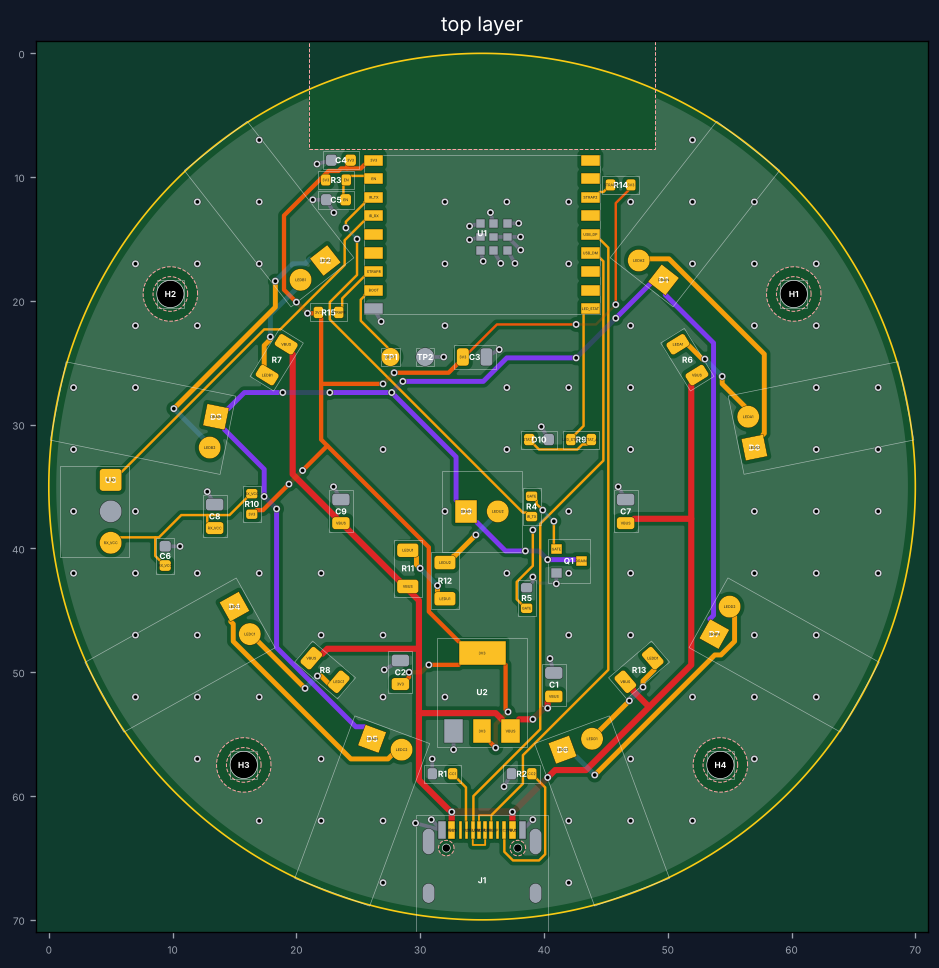

# Shimushili IR – כרטיס v0.3 (עגול, 360°, ESP32-C3)

כרטיס עגול בקוטר 70 מ"מ, שתי שכבות, ESP32-C3 עם USB-C. כל הרכיבים נתמכים בהרכבה **Economic** של JLC, כך שאין תוספת של 25$ על Standard. **8 נורות IR סביב השפה** שמאירות החוצה לכל הכיוונים, ועוד **נורה אחת למעלה** שמחזירה מהתקרה. המכשיר שוכב שטוח על מדף ומכסה את כל החדר, בלי צורך לכוון אותו.

> ⚠️ **זה אב-טיפוס.** הכרטיס נבדק בתוכנה: מרווחים, רציפות של כל חיבור, קריאת הקבצים בכלי נפרד, וסקירה בלתי תלויה של ההתאמה הפיזית. הוא עוד לא יוצר ולא נבדק פיזית. **הזמן קודם 5 יחידות**, בדוק אותן, ורק אחר כך כמות.

## מה יש על הכרטיס
| חלק | תפקיד |
|---|---|
| U1 ESP32-C3-WROOM-02-N4 | המעבד + WiFi (‏4MB). האנטנה בקצה העליון, בלי נחושת סביבה |
| R14/R15 | נגדי 10k שמחזיקים את GPIO2 ו-GPIO8 גבוהים, כדי שהמעבד יעלה תקין ויוכל להיכנס למצב צריבה |
| D1–D8 TSAL6400 | 8 נורות IR ‏940nm בזווית רחבה (±25°) סביב השפה, **שוכבות** ומאירות החוצה. 4 שרשראות של 2, כ-105mA לכל שרשרת |
| D9 TSAL6400 | נורת IR שעומדת באמצע ומאירה לתקרה (החזרה לכל החדר) |
| Q1 AO3400A | מתג שמדליק את כל הנורות יחד |
| J1 USB-C | חשמל 5V **וגם** חיבור למחשב לצריבה (USB מובנה ב-C3, בלי מתאם) |
| U2 AMS1117-3.3 | מייצב 3.3V |
| U3 TSOP38238 | מקלט IR ללימוד שלטים, בשפה השמאלית (מסומן LEARN). החלון שלו פונה החוצה |
| D10 | נורת סטטוס ירוקה ליד המרכז (מסומנת STATUS): מהבהבת במצב הגדרה, מהבהבת קצר בכל שליחה |
| TP1/TP2 | נקודות BOOT ו-GND לשחזור במקרה חירום |
| H1–H4 | 4 חורי הברגה M2 בין הנורות |

**מארז:** עגול, בערך 74–76 מ"מ קוטר, והכרטיס שוכב בתוכו שטוח. צריך: טבעת שקופה ל-IR (או 8 חורים) מול הנורות שבשפה, חור או חלון שקוף בתקרת המארז מעל D9 ו-D10, חלון קטן בצד מול המקלט (LEARN), ופתח USB-C בצד.

## הזמנה מ-JLCPCB – צעד אחר צעד
1. jlcpcb.com ← **Order now** ← העלה את `output/shimushili-ir-gerbers.zip`.
2. הגדרות לוח: 2 שכבות, FR-4, ‏1.6 מ"מ. JLC מזהה לבד את המידה (70×70). צבע לבחירתך. גימור ENIG עדיף לפינים הצפופים של ה-USB-C.
3. הפעל **PCB Assembly**, צד עליון (Top), ובחר **Economic**. כל הרכיבים נתמכים בו.
4. העלה BOM: `output/shimushili-ir-BOM.csv`, ו-CPL: `output/shimushili-ir-CPL.csv`.
5. **בתצוגה המקדימה של JLC עבור על כל רכיב** ותקן סיבוב אם צריך:
   - U1: האנטנה לכיוון הקצה העליון.
   - J1: פתח ה-USB לכיוון הקצה התחתון.
   - D9: הצד השטוח של הנורה (קתודה, רגל קצרה) על הפד המרובע.
   - D10: הקתודה (הצד המסומן) לכיוון הפד הימני.
   - U3: הכיפה של המקלט לכיוון הקצה השמאלי.
   - U2 ו-Q1: לפעמים צריכים סיבוב של 180°.
6. **8 נורות השפה (D1–D8) לא נמצאות בקבצי ההרכבה, וזה בכוונה.** JLC מרכיבים נורות עומדות, ואז הן היו מאירות לתקרה. אותן מרכיבים ידנית (ראה למטה). הוסף להזמנה 8 יחידות TSAL6400 לכל כרטיס (LCSC ‏C94857), או שאל את JLC בהערות להזמנה אם הם יכולים לכופף ולהרכיב לפי `output/shimushili-ir-hand-fit.csv`.

## הרכבת 8 הנורות שבשפה (בערך 3 דקות לכרטיס)
1. כופף את שתי הרגליים של הנורה ב-90° במרחק **3.8 מ"מ מגוף הנורה**. אפשר בעזרת פלאייר או ג'יג פשוט.
2. הכנס לחורים כך שהנורה שוכבת על הכרטיס והעדשה פונה **החוצה לשפה**.
3. הרגל הקצרה (קתודה) נכנסת לפד **המרובע**.
4. הלחם מהצד התחתון וקצץ את הרגליים.

## אחרי שהכרטיסים מגיעים
1. חבר USB-C למחשב. המחשב יזהה אותו מיד, בלי מתאם.
2. צרוב את `firmware-esp32c3-factory.bin` מהקישור:
   `https://github.com/ronagayan/shimushili.ir/releases/download/firmware-latest/firmware-esp32c3-factory.bin`
   (כתובת 0x0, למשל עם ‎esptool.py --chip esp32c3 write_flash 0x0 firmware-esp32c3-factory.bin‎)
3. משם האפליקציה עושה הכל: חיבור ל-WiFi, הגדרת מזגן וטלוויזיה, ועדכונים.
4. אם הכרטיס לא מזוהה ב-USB: קצר את TP1 (BOOT, ‏GPIO9) ל-TP2 (GND) בפינצטה, חבר את ה-USB, ואז שחרר.

## רשימת בדיקה לאב-טיפוס
- [ ] 3.3V יציב על C2 (במולטימטר)
- [ ] המחשב מזהה את הכרטיס ב-USB, בשני כיווני הכבל
- [ ] צריבה עובדת, ונורת הסטטוס מהבהבת במצב הגדרה
- [ ] WiFi: האפליקציה מוצאת את השלט (בדוק גם כשהמכשיר בתוך המארז)
- [ ] שידור: טלוויזיה ומזגן מגיבים מכל כיוון בחדר, גם מאחורי המכשיר
- [ ] לימוד: המקלט קולט שלט מקרוב מצד LEARN
- [ ] במחשב נייד (יציאת USB של 500mA) הכרטיס לא נכבה בזמן שידור. במטען טלפון אין בעיה

## הערות טכניות
- ‏GPIO: ‏IR TX = GPIO4 (דרך 100Ω ל-AO3400A, ‏10k pulldown), ‏IR RX = GPIO5, סטטוס = GPIO10, ‏BOOT = GPIO9, ‏USB D-/D+ = GPIO18/19. הקושחה 1.5.0 ומעלה מכירה את הכרטיס הזה (בנייה ל-esp32c3, מחיצות min_spiffs, ‏flash ב-DIO).
- קבל ה-22µF של ה-3.3V ‏(C3) רחוק בערך 25 מ"מ מפין ה-3V3 של המודול, וליד הפין יש רק 100nF ‏(C4). זה אמור לעבוד, אבל אם באב-טיפוס יש אתחולים מקריים בזמן WiFi, בגרסה הבאה כדאי להוסיף 10µF צמוד ל-C4.
- זרם הנורות: 4 שרשראות × כ-105mA + נורה עליונה כ-83mA, כלומר כחצי אמפר בשיא, רק בזמן שידור. TSAL6400 עומדת ב-200mA בפולסים, ושידור IR הוא תמיד פולסים. במצב תקלה שבו השידור נתקע דלוק, הנגדים (22Ω, ‏0.25W) עובדים קרוב לגבול. אם רוצים מרווח, נגדי 27Ω יורידו לכ-85mA ובערך 15% מהטווח.
- אין הגנת ESD/נתיך על ה-USB. כדאי להוסיף בגרסה הבאה (למשל USBLC6-2 + ‏polyfuse).
- כללים: מרווח מינימלי 0.15 מ"מ, מסלולים 0.2–0.6 מ"מ, ויות 0.3/0.6, לפחות 0.5 מ"מ בין חורים של חיבורים שונים, נחושת לפחות 0.6 מ"מ מהקצה. אין נחושת ברדיוס 5 מ"מ סביב האנטנה.
- ה-USB-C בולט כחצי מ"מ מעבר לשפה העגולה, וזה מכוון כדי שהתקע ייכנס עד הסוף.

## מבנה התיקייה
| נתיב | מה |
|---|---|
| `output/shimushili-ir-gerbers.zip` | **הקובץ להעלאה ל-JLC** (גרברים + קידוחים) |
| `output/*-BOM.csv`, `output/*-CPL.csv` | רשימת רכיבים ומיקומים להרכבה (בלי D1–D8) |
| `output/*-hand-fit.csv` | 8 נורות השפה, להרכבה ידנית |
| `output/*-netlist.csv` | כל פין ← לאיזה חיבור (לבדיקה) |
| `output/preview-*.png` | תמונות של שתי השכבות |
| `tools/design.py` | **מקור העיצוב**: צורה, מיקום, חיבורים, מספרי חלקים. הרצה: `python3 tools/design.py` |
| `tools/pcbgen.py`, `tools/fabout.py`, `tools/render.py` | מנתב, בדיקות וכתיבת קבצי ייצור |
| `footprints/` | פוטפרינטים מהספריות הרשמיות של KiCad ושל Espressif (CC-BY-SA 4.0, עם חריג לעיצובים) |

תלויות: `pip install shapely numpy matplotlib networkx` (ול-render עצמאי של הגרברים: `gerbonara cairosvg`).

גרסאות קודמות (v0.1 מלבנית, v0.2 עם ESP32-S3) נמצאות בהיסטוריית ה-git.
